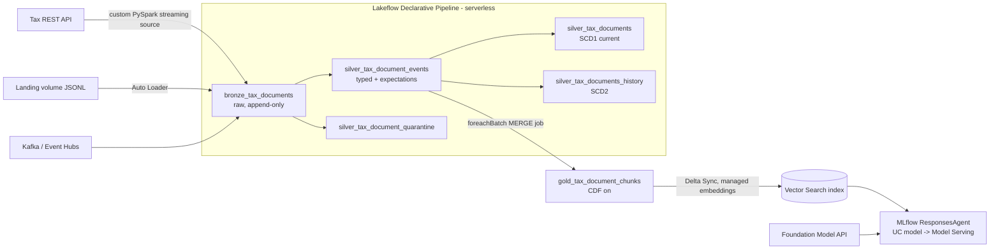

# Tax RAG: streaming tax documents → Unity Catalog → RAG agent (Databricks)

This project streams tax documents (statutes, regulations, rulings, guidance) from an upstream REST API into Unity Catalog. It cleans and documents them, chunks them into a Vector Search index, and serves a RAG agent with citations through Model Serving. Everything is deployed as a **Databricks Asset Bundle** with `dev`, `staging` and `prod` targets.

> **Status: work in progress.** The core code, tests and bundle are done. CI/CD workflows, the bootstrap scripts and the ops docs are still to do (see [Status](#status)).

## Architecture



| Layer | What happens |
|---|---|
| Ingest | `tax_api` custom streaming source (`src/tax_rag/ingest/datasource.py`) polls the API in time-window offsets. The checkpoint makes replays exactly-once. It retries 429/5xx and honours Retry-After. The `files` (Auto Loader) and `kafka` modes produce the same bronze schema. |
| Bronze | Raw JSON plus lineage. `pipelines.reset.allowed=false`, so a full refresh can't wipe history the API no longer holds. |
| Silver | Records are parsed (ANSI-safe), HTML is converted to text, and jurisdiction, tax type and document type are normalised. Contract expectations decide what happens to a bad record: `drop` sends it to quarantine, `warn` only tracks it. AUTO CDC builds SCD1 (current) and SCD2 (history) tables. |
| Gold | Structure-aware chunks with a metadata header (jurisdiction, tax type, year). An idempotent MERGE deletes superseded or deleted versions and ignores late older versions. |
| Retrieval | Vector Search Delta Sync index (HYBRID), with `TRIGGERED` sync in dev/staging and `CONTINUOUS` in prod. |
| Agent | Answers only from the sources it retrieves. It cites every source, refuses when the sources don't answer, filters by `as_of` effective date, and treats retrieved text as data, not instructions. |
| Release | The agent is logged from code and registered in UC. MLflow GenAI evaluation (relevance, groundedness, safety, correctness, citations) gates `agents.deploy`. The `champion` alias marks the deployed version, and rollback is a job. |
| Governance | One data contract (`src/tax_rag/contracts/tax_documents.yml`) drives table schemas, column comments, expectations, UC tags and `docs/data_dictionary.md`. |

## Environments (bundle targets)

| | dev | staging | prod |
|---|---|---|---|
| Mode | development (per-user prefix, paused schedules) | production, runs as SP | production, runs as SP |
| Catalog | `tax_dev` (schema `dev_<user>_tax_rag`) | `tax_staging` | `tax_prod` |
| Source | `files` (fixtures) | `files` (fixtures; switch to vendor sandbox API) | `api` |
| Pipeline / chunk sync / index | triggered / available-now / TRIGGERED | triggered / available-now / TRIGGERED | continuous / continuous / CONTINUOUS |
| Eval set | `evals/fixture_eval_set.jsonl` | same | `evals/prod_eval_set.jsonl` (**must be curated; release fails without it**) |

## Repository layout

```
databricks.yml                 bundle + targets (dev/staging/prod) + variables
resources/                     schema, volumes, experiment, pipeline, jobs
src/pipelines/tax_ingest.py    Lakeflow pipeline (bronze -> silver, SCD1/SCD2)
src/tax_rag/
  ingest/                      REST client + PySpark streaming data source
  transform/                   cleaning, chunking, Spark silver transforms
  catalog/contract.py          data contract -> DDL, expectations, UC tags, docs
  contracts/tax_documents.yml  the data contract
  gold/chunk_sync.py           silver -> gold chunk MERGE stream
  vector/index.py              Vector Search endpoint + index setup
  rag/                         engine, prompts, Databricks clients, MLflow agent
  release/                     register / evaluate (quality gate) / deploy
  verify/checks.py             post-deploy data + endpoint checks
  cli.py                       `tax-rag` entry point used by every job task
tests/                         unit + local-Spark integration tests, mock API, fixtures
evals/                         eval set gating releases
docs/data_dictionary.md        generated from the contract (`python scripts/gen_docs.py`)
```

## Local development

```bash
uv venv && uv pip install -e ".[dev]"     # needs Java 17+ for the Spark tests
pytest                                     # 65 tests: unit + local Spark (real streaming source vs mock API)
ruff check . && ruff format --check .
python scripts/gen_docs.py                 # regenerate the data dictionary after contract edits
python tests/mock_tax_api.py --port 8765   # contract-faithful mock of the tax API
```

## Deploy (manual, until CI/CD lands)

```bash
databricks auth login --host https://<workspace>
databricks bundle validate -t dev
databricks bundle deploy   -t dev
# upload tests/fixtures/tax_documents.jsonl to /Volumes/tax_dev/<schema>/landing/incoming/
databricks bundle run -t dev tax_ingest          # Lakeflow pipeline
databricks bundle run -t dev tax_rag_chunk_sync  # gold chunks + vector index
databricks bundle run -t dev tax_rag_release     # governance, register, eval gate, deploy
databricks bundle run -t dev tax_rag_verify      # data health + endpoint smoke test
```

Prerequisites (one-time, by an admin):
- Catalogs `tax_dev`, `tax_staging` and `tax_prod`.
- Secret scope `tax-rag` with key `tax-api-token`.
- A deploy service principal per environment (`BUNDLE_VAR_service_principal`).
- Access to the `llm_endpoint` and `embedding_endpoint` serving endpoints.

## Status

Done:
- Streaming ingestion (API / Auto Loader / Kafka) and the Lakeflow pipeline with contract-driven schemas and expectations.
- Gold chunk sync, Vector Search setup and the RAG agent.
- Evaluation gate, deploy and rollback jobs, plus verification checks.
- Asset Bundle with dev/staging/prod.
- 65 passing tests. The integration tests run the real custom streaming source end-to-end in local Spark.

To do:
- **CI/CD** (`.github/workflows/`):
  - PR: lint, tests, docs freshness check and `bundle validate` for all targets.
  - Merge to main: deploy staging, seed fixtures, run pipeline, chunk sync, release and verify. Then deploy prod behind a GitHub Environment approval, start the continuous pipeline and verify.
  - Auth via GitHub OIDC federation, with no long-lived tokens.
- Bootstrap scripts: UC catalogs and grants, secret scope.
- `docs/architecture.md`, `docs/runbook.md` (backfill, checkpoint reset, rollback, first prod deploy), `docs/api_contract.md`.
- A curated `evals/prod_eval_set.jsonl` built from real questions over the real corpus.
- First real deploy. The bundle hasn't been validated against a live workspace yet, and settings such as `environment_version`, `dynamic_version` and `ALTER STREAMING TABLE ... SET TAGS` need checking there.

## Assumptions to confirm

- "Tax data" here means a **public tax-law corpus**. Taxpayer records would mean PII, and that changes governance, masking and whether RAG is appropriate at all.
- The API contract is assumed to be `GET /v1/tax-documents?updated_from&updated_to&page_size&page_token`. Adapt `ingest/api_client.py` to the real vendor API.
- Fixtures use a fictional jurisdiction (`ZZ`, "Zedland") so nobody mistakes them for real tax law.
